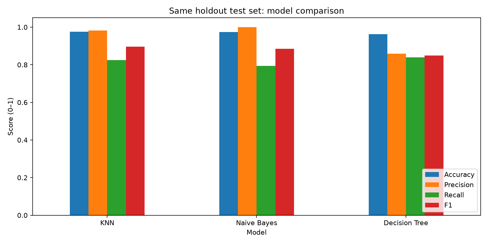
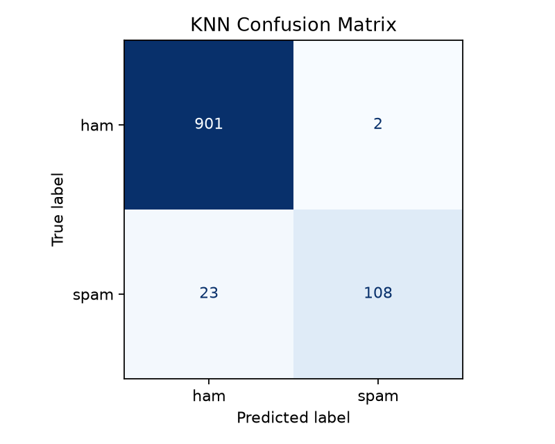
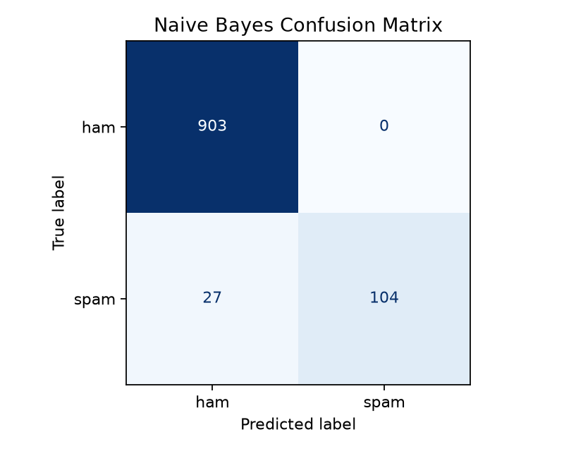
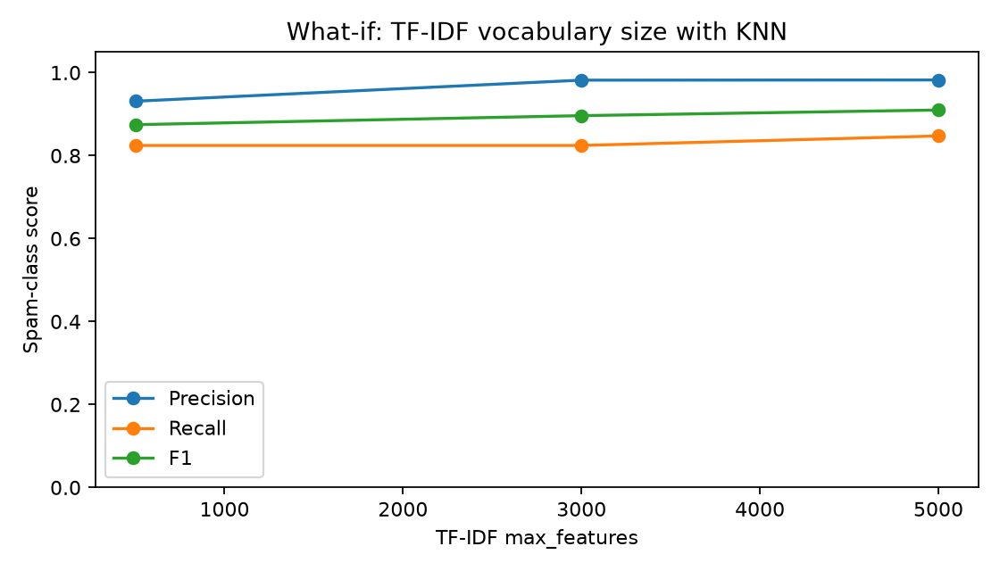

# Comparative Study of Text Classification Algorithms for SMS Spam Detection

A reproducible machine learning project comparing text classification algorithms on the benchmark **UCI SMS Spam Collection** dataset.

- **Detailed Academic Report**: See [REPORT.md](REPORT.md) for theoretical background, mathematical formulations, and literature citations.

---

## Experimental Results

The project was executed using Python 3.11 with an 80:20 stratified train-test split (`random_state=42`) on 5,166 cleaned SMS messages (4,132 training samples, 1,034 testing samples: 903 Ham, 131 Spam). All models used identical TF-IDF features (unigrams and bigrams, `min_df=2`, `max_features=3000`) fitted solely on the training set to prevent data leakage.

### 1. Performance Comparison Table
*(Source: `results/model_comparison.csv` — Spam is the positive class)*

| Model | Accuracy | Precision | Recall | F1-Score |
| :--- | :---: | :---: | :---: | :---: |
| **K-Nearest Neighbours (KNN)** | **0.9758** | 0.9818 | 0.8244 | **0.8963** |
| **Multinomial Naïve Bayes** | 0.9739 | **1.0000** | 0.7939 | 0.8851 |
| **Decision Tree** | 0.9623 | 0.8594 | **0.8397** | 0.8494 |

### 2. Performance Comparison Chart



### 3. Confusion Matrices

Individual confusion matrices for each evaluated algorithm on the 1,034 holdout test samples:

#### K-Nearest Neighbours (KNN)
- **True Negative (Ham correctly identified)**: 901
- **False Positive (Ham misclassified as Spam)**: 2
- **False Negative (Spam missed)**: 23
- **True Positive (Spam intercepted)**: 108



#### Multinomial Naïve Bayes
- **True Negative (Ham correctly identified)**: 903
- **False Positive (Ham misclassified as Spam)**: 0
- **False Negative (Spam missed)**: 27
- **True Positive (Spam intercepted)**: 104



#### Decision Tree
- **True Negative (Ham correctly identified)**: 885
- **False Positive (Ham misclassified as Spam)**: 18
- **False Negative (Spam missed)**: 21
- **True Positive (Spam intercepted)**: 110


### 4. What-If Experiment: TF-IDF Vocabulary Size with KNN

The controlled what-if experiment evaluates how varying TF-IDF `max_features` between 500, 3,000, and 5,000 impacts the K-Nearest Neighbours classifier under the identical train-test split:

*(Source: `results/what_if_tfidf_features.csv`)*

| `max_features` | Accuracy | Precision | Recall | F1-Score |
| :---: | :---: | :---: | :---: | :---: |
| **500** | 0.9700 | 0.9310 | 0.8244 | 0.8745 |
| **3000** | 0.9758 | 0.9818 | 0.8244 | 0.8963 |
| **5000** | **0.9787** | **0.9823** | **0.8473** | **0.9098** |



**Analysis of Actual Values**:
- At **500 features**, the limited vocabulary omits distinct but less frequent spam tokens, causing more false alarms and lowering precision to **0.9310** (F1: **0.8745**).
- At **3,000 features**, precision sharply rises to **0.9818** and F1 reaches **0.8963**.
- At **5,000 features**, additional specific n-grams allow KNN's cosine distance metric to better capture subtle spam phrasing, achieving the highest recall (**0.8473**), accuracy (**0.9787**), and F1-score (**0.9098**).

### 5. Conclusion: Best-Performing Algorithm

- **Overall Best Classifier**: **K-Nearest Neighbours (KNN)** achieves the highest spam F1-score (**0.8963**) and highest overall accuracy (**0.9758**). By using the **cosine distance metric**, KNN effectively handles sparse TF-IDF vectors by measuring angle orientation rather than vector length, striking an optimal balance between precision (0.9818) and recall (0.8244).
- **Conservative Filtering Champion**: **Multinomial Naïve Bayes** achieved **1.0000 Precision** with **zero false positives** (`FP = 0`), ensuring no genuine message is ever lost, though with slightly lower spam recall (0.7939).
- **Least Effective**: **Decision Tree** scored lowest in precision (0.8594) and F1 (0.8494) due to generating 18 false positives from rigid, single-word partition thresholds.

---

## Setup & How to Run

### Prerequisites
- Python 3.11+ installed on Windows, macOS, or Linux.

### 1. Create and Activate Virtual Environment
```powershell
python -m venv .venv
.\.venv\Scripts\Activate.ps1
```
*(On Linux/macOS, run `source .venv/bin/activate`)*

### 2. Install Required Dependencies
```powershell
python -m pip install --upgrade pip
python -m pip install -r requirements.txt
```

### 3. Run Pipeline and Regenerate Results
```powershell
python main.py
```
Executing `main.py` will:
1. Load and clean the raw dataset from `data/SMSSpamCollection`.
2. Perform the 80:20 stratified split.
3. Fit the TF-IDF pipeline and train Naïve Bayes, Decision Tree, and KNN.
4. Run the KNN what-if feature size experiment.
5. Save all updated CSVs, predictions, and PNG visualizations into the `results/` folder.

---

## Directory Structure

```
SMS_Spam_Classification_Project/
├── data/
│   └── SMSSpamCollection          # Official UCI dataset
├── results/
│   ├── model_comparison.csv       # Comparative metrics table
│   ├── model_comparison.png       # 3-model comparative bar chart
│   ├── test_predictions.csv      # Test samples with predictions
│   ├── what_if_tfidf_features.csv # KNN feature experiment table
│   ├── what_if_experiment.png     # KNN feature experiment plot
│   ├── confusion_knn.png          # KNN confusion matrix plot
│   ├── confusion_naive_bayes.png  # Naïve Bayes confusion matrix plot
│   └── confusion_decision_tree.png# Decision Tree confusion matrix plot
├── main.py                        # Executable ML pipeline
├── REPORT.md                      # Comprehensive academic report
├── requirements.txt               # Pinned dependencies
├── README.md                      # Project documentation with results
└── .gitignore                     # Git ignore rules
```

---

## Software Environment Record

- **Python**: 3.11.9
- **scikit-learn**: 1.9.1
- **pandas**: 2.3.3
- **matplotlib**: 3.11.2
- **numpy**: 2.4.6
- **scipy**: 1.17.1
